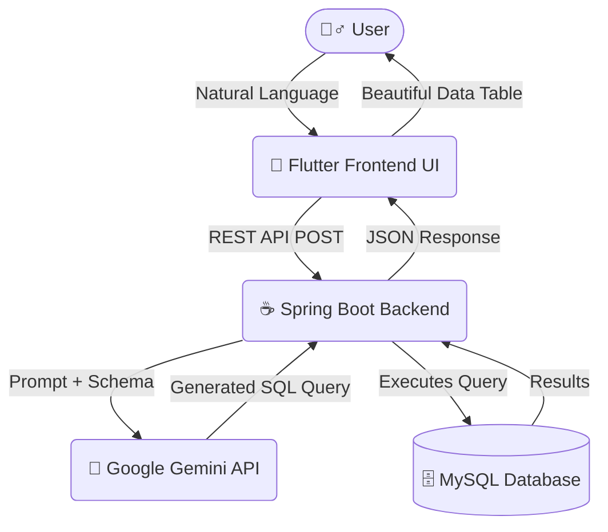

# 🧠 Natural Language to SQL AI System (NL2SQL) 🚀

<div align="center">

;; 

[](#)
[](#)
[](#)
[](#)
[](#)
[](#)
[](#)

**"Stop writing complex `JOIN`s. Start talking to your data. No cap."** 🗣️ ➡️ 🗄️

[Explore Features](#-features) • [Installation](#-speedrun-setup-get-it-running-in-2-mins) • [Architecture](#%EF%B8%8F-next-gen-architecture) • [Contribute](#-how-to-contribute-join-the-wave)
</div>

---

## 🌟 The Vision (Why we built this)
Let’s be real. Writing SQL queries for complex databases is *so* 2010. What if you could just text your database like you text your friends? 

*“Hey, who in the CSE branch passed math but failed physics last semester?”*

**NL2SQL** is a cutting-edge, AI-powered system that seamlessly translates plain English (Natural Language) into optimized, fully functional SQL queries. We wired **Google's Gemini 2.5 Flash** into an ultra-fast **Spring Boot** backend and wrapped it in a gorgeous **Flutter** cross-platform app. 

Whether you're a non-technical CEO or an exhausted developer needing a break, this project is designed to give you **instant insights** without writing a single line of SQL.

This project is open-source, highly aesthetic, and ready for you to clone and scale. **Star this repo ⭐ if you think the future is AI-driven!**

---

## ⚡ What makes it bussin' (Features)
- 🧠 **Context-Aware AI Generation**: Powered by the Gemini API. It understands complex relations, aggregates, and weirdly phrased questions.
- ⚡ **Lightning Fast Execution**: Our SDK handles requests with almost zero latency via Java Spring Boot.
- 📱 **Cross-Platform Supremacy**: Built with Flutter. It looks flawless on Mobile, Web, and Desktop. Peak aesthetic UI.
- 🐳 **One-Click Deployment**: Fully Dockerized. You don't need to configure MySQL or Java locally. Run `docker-compose up` and you're chilling.
- 🔐 **Secure & Private**: It generates SQL intelligently without exposing raw DB credentials directly to the AI model.
- 🎨 **Dark Mode Native**: Because light mode is an optical illusion.

---

## 🛠️ Next-Gen Architecture

<div align="center">


*(Rendered seamlessly if you're using GitHub)*
</div>

### 📦 Tech Stack Breakdown
| Layer | Technologies Used | Why We Picked It |
| :--- | :--- | :--- |
| **Frontend** | Flutter, Dart | Smooth animations, 60fps, cross-platform from a single codebase. |
| **Backend** | Spring Boot 3+, Hibernate | Enterprise-grade reliability and lightning-fast request handling. |
| **AI Core** | Google Gemini API (v1beta) | Unmatched LLM reasoning speed and accuracy for text-to-SQL logic. |
| **Database** | MySQL 8.0 | Robust, ACID-compliant relational data management. |
| **DevOps** | Docker, Docker Compose | Eradicates the "it works on my machine" curse forever. |

---

## 🚀 Speedrun Setup (Get it running in 2 mins)

> [!IMPORTANT]  
> Make sure you have [Docker Desktop](https://www.docker.com/products/docker-desktop) installed and running before starting.

### 1️⃣ Clone the Repository
```bash
git clone https://github.com/your-username/NLtoSQL_System.git
cd NLtoSQL_System
```

### 2️⃣ Secure Your API Keys
Open the `.env` file in the root directory. Replace the placeholders with your actual secrets.
```env
# Get this from Google AI Studio: https://aistudio.google.com/
GEMINI_API_KEY=your_gemini_api_key_here

# Set your secure database passwords
MYSQL_ROOT_PASSWORD=your_secure_root_password
MYSQL_DATABASE=nl2sql_student
```

### 3️⃣ IGNITE! 🔥
Build and start the entire stack (Frontend, Backend, and Database) with a single command.
```bash
docker-compose up --build -d
```
> *Docker will now pull the images, run the database migrations (including our massive 100+ row dummy dataset), and start the servers.*

### 4️⃣ Access the App 
- **🌐 UI Dashboard:** [http://localhost](http://localhost) *(Port 80)*
- **🔌 Backend API:** [http://localhost:8080](http://localhost:8080)
- **🗄️ Database Port:** `3307` *(Mapped to 3306 internally)*

---

## 📸 Sneak Peek (UI Previews)

<div align="center">

*Want to see what it looks like? Here's the aesthetic.*

| 💬 Chat Interface | 📊 Query Results |
| :---: | :---: |
| Then fork this repo!! | Setup your fork!! |

</div>

---

## 💖 Why You Should Star ⭐ This Repo!
If you've ever felt the pain of writing a 12-line SQL query just to get a simple answer, this project is for you. 

We are actively maintaining this project and building out **new features**! By starring this repo, you push us in the GitHub feed, help us gain visibility, and allow us to bring in more epic contributors. Let's make accessing data a breeze for everyone.

**If you love it, smash that ⭐ button! It means the world.**

---

## 🤝 How to Contribute (Join the Wave)

We are always looking for go-getters to help make this system even more cracked. Found a bug? Have an aesthetic tweak for the UI? Want to add support for PostgreSQL? 

1. **Fork** the repository.
2. **Create a Branch:** `git checkout -b feature/EpicNewFeature`
3. **Commit your changes:** `git commit -m 'Added dark mode toggle and fixed a crash'`
4. **Push to Branch:** `git push origin feature/EpicNewFeature`
5. **Open a Pull Request:** We'll review it ASAP and get it merged!

If you're unsure where to start, check the **Issues** tab!

---

## 💬 Let's Connect
Got thoughts? Want to vent about how hard SQL can be? Drop a comment in the **Discussions** tab or open an **Issue**. We engage with absolutely everyone. 
- **Developer:** [@bhagyaprasad92](https://github.com/Bhagyaprasad92) 
- **Report Bugs:** [Issue Tracker](https://github.com/Bhagyaprasad92/NLtoSQL_System/issues)

---

<div align="center">

### Built with ❤️ and copious amounts of caffeine.
**MIT License** © 2026 NLtoSQL Team

</div>
